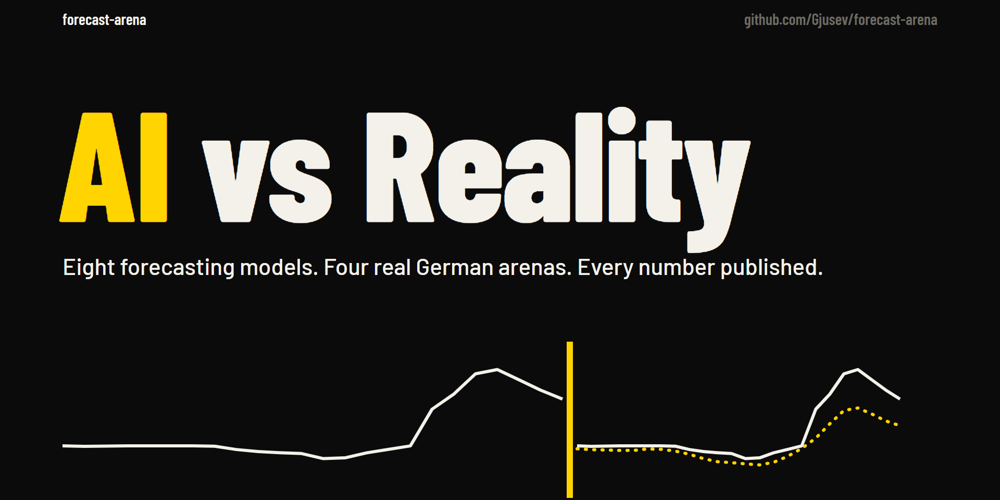
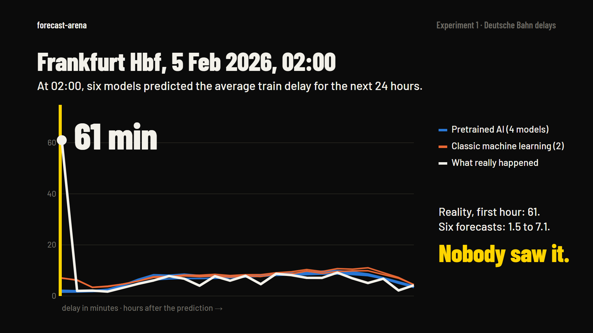
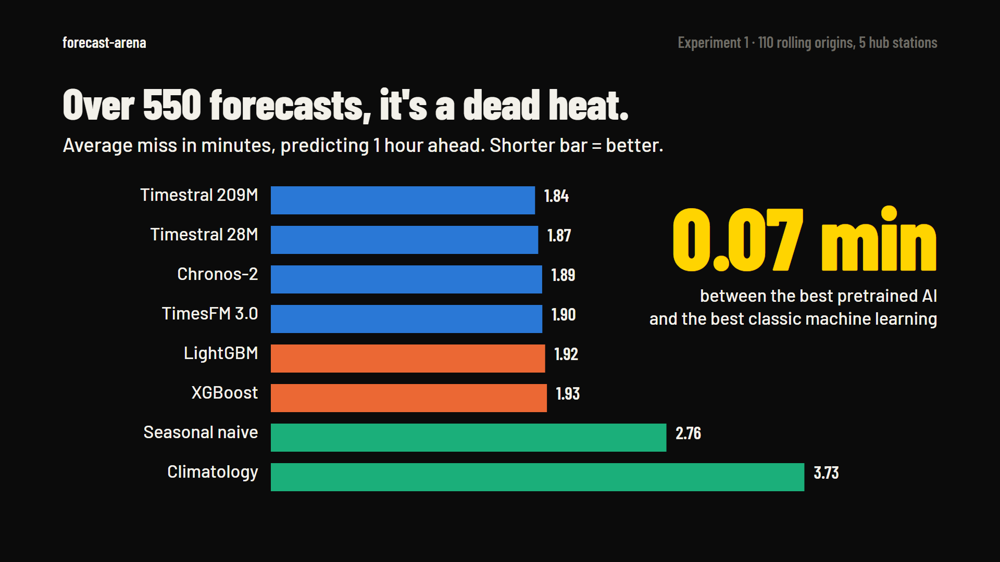
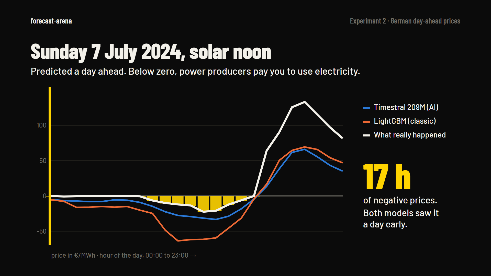
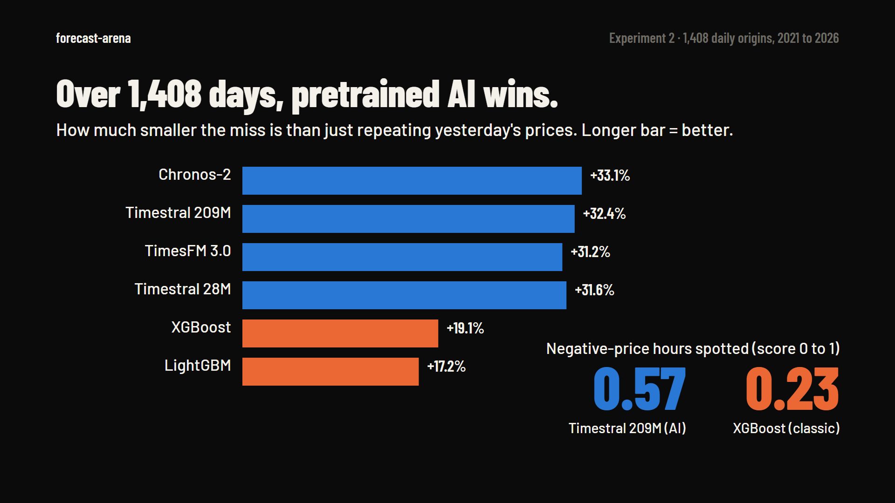
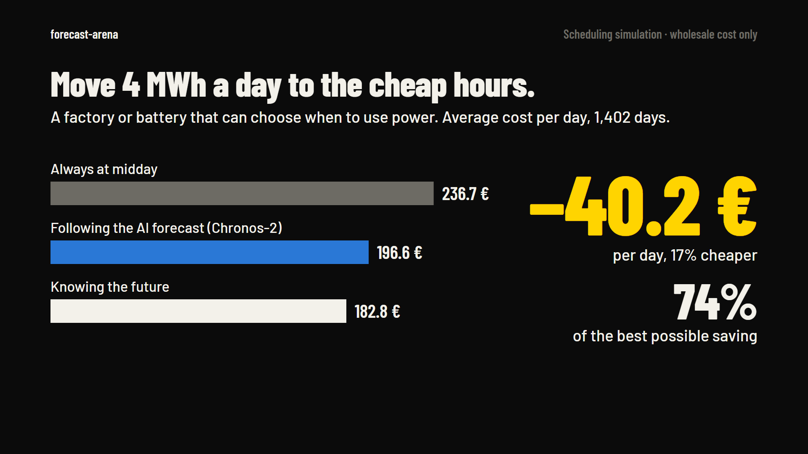
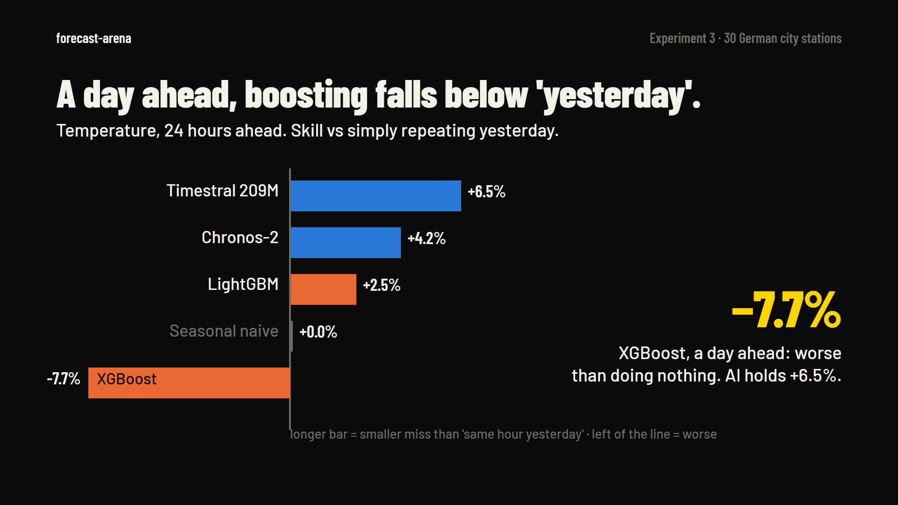
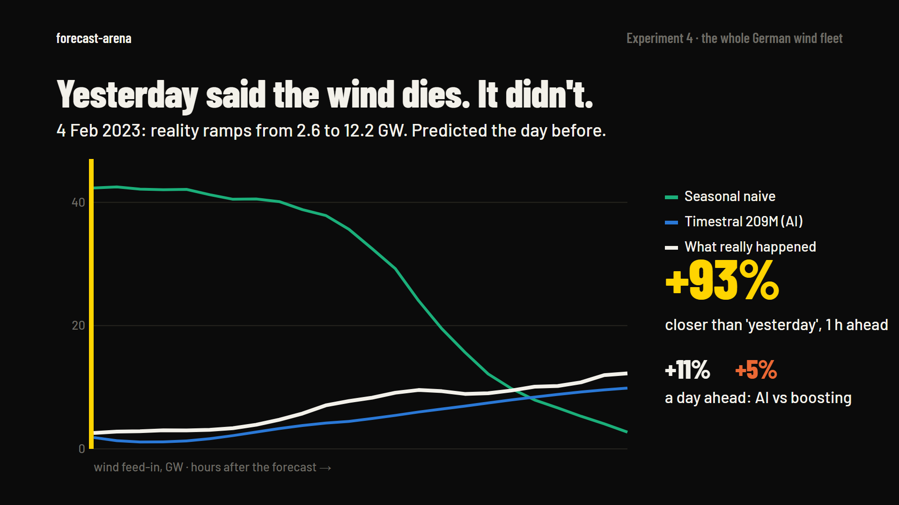

<p align="center">
  <a href="https://huggingface.co/spaces/Gjusev/forecast-arena">
    
  </a>
</p>

<p align="center">
  <a href="https://huggingface.co/spaces/Gjusev/forecast-arena"><b>Live demo</b></a> ·
  <a href="reports/01-train-delays.md">Train delays report</a> ·
  <a href="reports/02-electricity-prices.md">Electricity report</a> ·
  <a href="assets/video/forecast-arena.mp4">Watch the 45-second film</a>
</p>

<p align="center">
  <a href="https://github.com/Gjusev/forecast-arena/actions/workflows/ci.yaml"></a>
  
  
</p>

# forecast-arena

**Real data. Real predictions. Real results.** An open benchmark that tests
whether time series foundation models actually beat traditional methods on real,
messy operational data, with reproducible code, leakage-guarded protocols, and
the failures published next to the wins.

Vendors report wins on academic benchmarks. We re-test that claim on two systems
Germany runs on: **Deutsche Bahn train delays** and **day-ahead electricity prices**.

<p align="center">
  <a href="assets/video/forecast-arena.mp4">
    
  </a>
  <br><sub>Click for the full-resolution MP4 (1080p, 45 s). Every number comes from <code>assets/video/story.json</code>, exported from the committed results.</sub>
</p>

## What we found

### 1. Trains: everyone misses the same disruption



The worst hour in the test window: Frankfurt (Main) Hbf, 5 Feb 2026. Average
arrival delay hit **61 min**; six models forecast **1.5 to 7.1 min**. Hourly
aggregates alone cannot see an incident coming, whichever model reads them.

### 2. Trains: a dead heat over 550 forecasts



MAE in minutes, 1 hour ahead, 5 hub stations × 110 rolling origins, vs **seasonal naive 2.76**:

| Model | MAE | Skill vs naive | 80%-interval coverage |
|---|---|---|---|
| Timestral 209M | **1.84** | +33.2% | 0.78 |
| Timestral 28M | 1.87 | +32.4% | 0.77 |
| Chronos-2 | 1.89 | +31.4% | 0.76 |
| TimesFM 3.0 | 1.90 | +31.4% | 0.79 |
| LightGBM | 1.92 | +30.7% | — |
| XGBoost | 1.93 | +30.2% | — |

Every serious model beats naive by ~30% (p < 1e-8), but the best foundation model
and laptop-trained gradient boosting are **0.07 minutes** apart.

### 3. Power: the models saw the free-power Sunday coming



An illustrative solar Sunday (7 July 2024, chosen because it shows the mechanism
clearly): 17 hours below zero, forecast the morning before the auction. The
aggregate numbers below are the honest test.

### 4. Power: over 1,408 days, foundation models win



MAE €/MWh pooled over all 24 delivery hours, 1,408 daily pre-auction origins (2021–2026), vs **seasonal naive 28.20**:

| Model | MAE | Skill vs naive | Neg-price F1 |
|---|---|---|---|
| Chronos-2 | **19.27** | +33.1% | 0.50 |
| Timestral 209M | 19.53 | +32.4% | **0.57** |
| TimesFM 3.0 | 19.82 | +31.2% | 0.48 |
| Timestral 28M | 19.82 | +31.6% | 0.53 |
| XGBoost | 23.48 | +19.1% | 0.23 |
| LightGBM | 24.14 | +17.2% | 0.19 |

The opposite of the delays result: foundation models clearly beat gradient
boosting (+31–33% vs +17–19%), and GBMs are nearly blind to negative-price hours.

### 5. Does it pay? On wholesale prices, yes



Scheduling 4 MWh of flexible daily load on the best model's forecast saved
**40.2 €/day (−17%)** vs a fixed midday schedule, capturing **74% of the
perfect-foresight saving** (wholesale costs only, not household bills).

### 6. Weather, 30 German cities: boosting falls below 'yesterday'



Predicting temperature 24 hours ahead across 30 city stations, the four
foundation models hold a real edge over repeating yesterday (+4.2% to +6.5%)
while XGBoost falls **below the naive rule** (−7.7%). At 1 hour ahead
everything beats naive by ~80% - the interesting signal is at the long horizon.

### 7. Renewables: AI sees the wind ramp coming



On 4 Feb 2023 the German wind fleet ramped from 2.6 to 12.2 GW while simply
repeating yesterday expected 42 GW collapsing. Timestral 209M tracked the ramp.
Across 307 daily origins the pretrained models hold **+11%** over repeating
yesterday at a day ahead; classic boosting only **+5%**.

Publication charts: [`assets/charts/`](assets/charts/) · full reports: [`reports/`](reports/).

## Explore it yourself

The [live demo on Hugging Face Spaces](https://huggingface.co/spaces/Gjusev/forecast-arena)
reads the same committed result files:

- **Replay a forecast.** Scrub through every forecast origin, pick your
  contenders, call the winner, then reveal what really happened.
- **Leaderboard.** Rank by error or skill, per horizon, with runtimes.
- **Head to head.** Any two models, every forecast as one dot, win rate.
- **Does it pay?** Cumulative scheduling savings per model against perfect foresight.
- **Live.** Every day at 00:45 CET the workflow publishes forecasts for the *next*
  day's auction, committed before that auction runs (12:00 CET). Once the day's
  prices are out, the same workflow scores them: a rolling, tamper-evident
  leaderboard. See `live/` and `scripts/live_forecast.py`.

```bash
uv run --extra dashboard python dashboard/app.py   # -> http://localhost:7860
```

## Experiments

| # | Experiment | Question | Data |
|---|---|---|---|
| 1 | [Train delays](experiments/01-train-delays/) | Can Timestral-209M predict Deutsche Bahn disruption levels hours ahead? | 5 major stations, 2024-07 → 2026-10, ~5.7M arrivals |
| 2 | [Electricity prices](experiments/02-electricity-prices/) | Can small foundation models predict negative prices and spikes in the German day-ahead market? | DE-LU hourly day-ahead prices, 2018-10 → today |
| 3 | [DWD weather](experiments/03-dwd-weather/) | Do pretrained models beat simple baselines on the daily weather cycle, and do they catch heat hours? | 30 German city stations, hourly 2m temperature, 2015 → today |
| 4 | [Renewables](experiments/04-renewables/) | Can models forecast tomorrow's wind and solar feed-in? | DE-LU wind onshore/offshore + solar, hourly, 2019 → today |

*Collecting:* river gauges (PEGELONLINE, 738 stations) are accumulating history via
`scripts/collect_pegelonline.py` for a future water-level experiment — the public API
only serves 31 days, so collection started 2026-11-06. See [docs/dataset-research.md](docs/dataset-research.md).

## Models

| Family | Models |
|---|---|
| Foundation (zero-shot) | Mistral **Timestral 28M / 209M**, Amazon **Chronos-2**, Google **TimesFM 3.0** |
| Traditional ML | **LightGBM**, **XGBoost** (lag + calendar features, retrained per origin) |
| Statistical baselines | **Seasonal naive (24h)**, **hour-of-week climatology** |

Every model receives *identical* information at every forecast origin; see the
methodology below.

## Methodology (short version)

- **Rolling-origin evaluation** — chronological splits, no shuffling, identical
  origins and inputs for every model.
- **Leakage guards by construction** — models only ever receive history
  truncated at the origin ([ADR-0001](docs/adr/0001-completed-hour-forecasting-protocol.md),
  [ADR-0002](docs/adr/0002-pre-auction-day-ahead-protocol.md)).
- **Pre-registered event thresholds** — disruption / negative-price / spike
  thresholds frozen on training data before holdout evaluation.
- **Honest metrics** — MAE, RMSE, MASE vs seasonal naive, sMAPE where valid
  (never MAPE on prices), interval coverage, detection precision/recall,
  inference runtime.
- **Significance** — Diebold-Mariano tests vs the best baseline with a
  multiple-testing caveat stated.

## Quickstart

```bash
# Python 3.11+ via uv
uv sync --group dev --extra ml --extra foundation

# fetch data + build aggregates
uv run arena build-data 01
uv run arena build-data 02
uv run arena build-data 03   # weather (downloads ~130 MB from DWD)
uv run arena build-data 04   # renewables (energy-charts API)

# run benchmarks (smoke -> pilot -> full)
uv run --extra ml --extra foundation arena run 01 --tier smoke
uv run --extra ml --extra foundation arena run 03 --tier pilot   # weather
uv run --extra ml --extra foundation arena run 04 --tier pilot   # renewables
uv run --extra ml --extra foundation arena run 01 --tier pilot
uv run --extra ml --extra foundation arena run 02 --tier smoke

# tests (no model downloads)
uv run pytest tests -q
```

## Brand and media

| Asset | File |
|---|---|
| Logo mark (SVG / PNG) | [`assets/brand/mark.svg`](assets/brand/mark.svg), [`mark-512.png`](assets/brand/mark-512.png) |
| Banner / social preview (2:1) | [`assets/brand/banner.png`](assets/brand/banner.png) |
| Motion film (1080p MP4, GIF preview, stills) | [`assets/video/`](assets/video/) |
| Storyboard | [`assets/video/STORYBOARD.md`](assets/video/STORYBOARD.md) |

The mark is the benchmark's core idea: history runs up to the **forecast origin**
(the yellow bar), then splits into the forecast (dotted, signal yellow) and
reality (paper white). The film is deterministic SVG rendered frame by frame:

```bash
uv run python scripts/export_story_data.py                     # numbers from committed results
uv run --with playwright python scripts/render_motion.py all   # needs Chrome + ffmpeg
```

## Repository layout

```
experiments/        one folder per experiment (config + results + reports)
src/forecast_arena/
  data/             dataset loaders and panel builders
  models/           forecaster interface + adapters (baselines, GBMs, foundation)
  evaluation/       metrics, protocol, runner, analysis, simulation
  visualization/    publication charts
dashboard/          Gradio app over cached results (deployed as the HF Space)
assets/             brand, motion film + storyboard, publication charts
docs/adr/           accepted methodology decisions
reports/            technical reports + LinkedIn drafts (English)
```

## Data sources & licenses

| Data | Source | License |
|---|---|---|
| DB train delays | [piebro/deutsche-bahn-data](https://huggingface.co/datasets/piebro/deutsche-bahn-data) (aggregated Deutsche Bahn timetable data) | CC-BY-4.0 |
| Day-ahead prices | [SMARD](https://www.smard.de) (Bundesnetzagentur), filter 4169 | dl-de/by-2-0 |

This repository ships download scripts and small derived aggregates only —
raw datasets stay with their publishers under their terms.

## Limitations (the honest part)

- Train-delay forecasts are **operational-planning forecasts** on completed
  hourly aggregates, not individual-train predictions (real dispatch systems
  see en-route trains; our models do not — results are a lower bound).
- Electricity forecasts respect the day-ahead auction clock; they compete
  with professional traders who see more than hourly public data.
- Benchmarks run on consumer hardware (CPU); runtimes are reported per model
  but wall-clock comparability across hardware is approximate.

## License

MIT for code. See [LICENSE](LICENSE). Datasets keep their upstream licenses.

## Contributing

See [CONTRIBUTING.md](CONTRIBUTING.md) — methodology integrity first.
